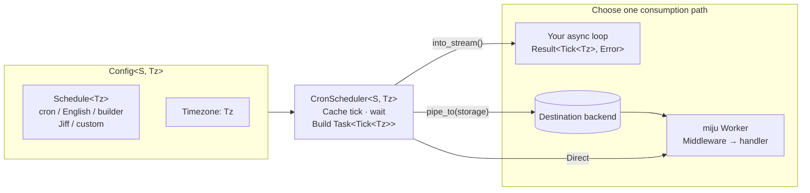
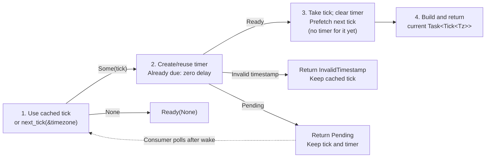

<p align="center">
  
</p>

<h1 align="center">miju-cron</h1>

<p align="center">
  <strong>Recurring task scheduling for Rust, built for miju Workers</strong>
</p>

<p align="center">
  <a href="https://crates.io/crates/miju-cron">
    
  </a>
  <a href="https://github.com/nanfeng-labs/miju-cron/actions/workflows/ci.yaml">
    
  </a>
  <a href="https://github.com/nanfeng-labs/miju-cron/blob/main/Cargo.toml">
    
  </a>
  <a href="https://github.com/nanfeng-labs/miju">
    
  </a>
</p>

<p align="center">
  <a href="https://github.com/nanfeng-labs/miju-cron/blob/main/README.zh-CN.md">简体中文</a>
</p>

miju-cron turns recurring schedules into typed tasks for miju Workers.

Use it for periodic reports, reminders, and maintenance jobs, or consume
scheduled ticks directly as a stream.

## Features

- **Scheduling formats**: cron expressions, English routines, a fluent builder, and Jiff schedules.
- **Timezones**: choose UTC, local time, or a named timezone supported by the adapter.
- **Worker middleware**: combine schedules with retries, shared data, and execution limits from miju.
- **Backend composition**: forward emitted tasks to a storage backend with `pipe_to`.
- **Custom schedules**: implement `Schedule<Tz>` for your own timing rules or finite sequences.
- **Configuration**: serialize ticks and compatible schedule configurations with Serde.

## Installation

Add these dependencies for the cron Worker example below.

```toml
[dependencies]
miju-cron = "0.2.0"
miju = "0.2.0"
cron = "0.17"
tokio = { version = "1", features = ["macros", "rt-multi-thread"] }
```

`cron` is explicit because the example imports `cron::Schedule`. The default miju-cron features are `cron` and `serde`.

## Usage

### Cron expressions and middleware

This Worker handles a tick every ten seconds. The six-field cron expression starts with seconds; `Data<String>` receives the value registered with `.data(...)`.

```rust,no_run
# #[cfg(feature = "cron")]
# mod example {
use cron::Schedule;
use miju::{layers::retry::RetryPolicy, prelude::*};
use miju_cron::{CronScheduler, Tick};
use std::str::FromStr;

async fn report(tick: Tick, name: Data<String>) {
    println!("{}: scheduled at {}", name.as_str(), tick.get_timestamp());
}

#[tokio::main]
async fn main() -> Result<(), BoxDynError> {
    let schedule = Schedule::from_str("*/10 * * * * *")?;
    WorkerBuilder::new("periodic-report")
        .backend(CronScheduler::new(schedule))
        .retry(RetryPolicy::retries(3))
        .data(String::from("daily-summary"))
        .build(report)
        .run()
        .await?;
    Ok(())
}
# }
```

`run()` waits until the Worker stops. Interrupt this example to exit, or use `WorkerContext::stop()` in an application.

The retry policy applies when a handler returns an error; the simple handler above always succeeds. See [basic](https://github.com/nanfeng-labs/miju-cron/blob/main/examples/basic.rs) for another shared-data example.

### Fluent schedules and timezones

Enable `builder` with `miju-cron = { version = "0.2.0", features = ["builder"] }`. For this example, also add `chrono = "0.4"` and `chrono-tz = "0.10"`.

```rust
# #[cfg(feature = "builder")]
# {
use miju_cron::{CronScheduler, builder::schedule};

let every_five_minutes = schedule().every(5).minutes().build::<chrono::Utc>();
let monday_morning = schedule().each().monday().at("09:30").build::<chrono_tz::Tz>();
let backend = CronScheduler::new(monday_morning)
    .with_timezone(chrono_tz::Asia::Shanghai);
# }
```

Pass `backend` to `.backend(...)` on a Worker builder. Its handler receives `Tick<chrono_tz::Tz>`. `every(5).minutes()` advances by five minutes; weekday selectors such as `.monday()` select weekly scheduling automatically. See [timezone](https://github.com/nanfeng-labs/miju-cron/blob/main/examples/timezone.rs) for a complete Worker using local time.

Minute/hour schedules without `.at(...)` measure elapsed time. Day/week schedules preserve local wall time.

Zero intervals, invalid times, date overflow, and ambiguous or nonexistent DST times end a builder schedule with `None`; choose an adapter whose DST policy fits your application. `at` accepts `:SS`, `HH:MM`, and `HH:MM:SS`, using the fields relevant to the selected unit.

### English routines

Enable the `english` feature and add `chrono = "0.4"` to use local time:

```rust
# #[cfg(feature = "english")]
# fn main() -> Result<(), Box<dyn std::error::Error>> {
use miju_cron::{CronScheduler, english::EnglishRoutine};

let routine = EnglishRoutine::new("every 5 minutes")?;
let backend = CronScheduler::new(routine).with_timezone(chrono::Local);
# Ok(())
# }
# #[cfg(not(feature = "english"))]
# fn main() {}
```

Parsing is case-insensitive and preserves the original input. Multiple clock times with different minutes (for example, `at 9:30 and 11:45`) return an error; use separate routines for these times.

English routines are converted to cron expressions, and their next occurrence is computed from the current clock. See [english](https://github.com/nanfeng-labs/miju-cron/blob/main/examples/english.rs) for Worker integration and [config](https://github.com/nanfeng-labs/miju-cron/blob/main/examples/config.rs) for a serialized schedule, timezone, and middleware configuration.

### Forwarding ticks to another backend

The scheduler itself is ephemeral. `pipe_to` lets another backend accept the tasks it emits. Add `miju-core = "0.2.0"` and `miju-file-storage = "0.2.0"` for this example:

```rust,no_run
# #[cfg(all(feature = "cron", feature = "serde"))]
# mod example {
use cron::Schedule;
use miju::prelude::*;
use miju_core::backend::ext::BackendExt;
use miju_cron::{CronScheduler, Tick};
use miju_file_storage::JsonStorage;
use std::str::FromStr;

#[tokio::main]
async fn main() -> Result<(), BoxDynError> {
    let schedule = Schedule::from_str("*/10 * * * * *")?;
    let storage = JsonStorage::new_temp()?;
    let backend = CronScheduler::new(schedule).pipe_to(storage);
    WorkerBuilder::new("file-backed-report")
        .backend(backend)
        .build(async |tick: Tick| {
            println!("Received {}", tick.get_timestamp());
        })
        .run()
        .await?;
    Ok(())
}
# }
```

`new_temp()` creates temporary storage for demonstration. Only tasks delivered to the destination receive its storage guarantees; review the file backend's persistence and concurrency contract before using it in an application. This does not persist schedule rules, replay downtime, elect a leader, or provide exactly-once execution.

### Custom schedules

Implement `Schedule<Tz>` to return the next UTC UNIX timestamp in seconds. Return `None` when there are no more occurrences. This schedule emits two ticks:

```rust
use miju_cron::{CronScheduler, Schedule, Tick, timezone::Utc};
use std::collections::VecDeque;
use std::time::{SystemTime, UNIX_EPOCH};

#[derive(Debug)]
struct Occurrences(VecDeque<u64>);

impl Schedule<Utc> for Occurrences {
    fn next_tick(&mut self, _: &Utc) -> Option<Tick<Utc>> {
        self.0.pop_front().map(Tick::new)
    }
}

let now = SystemTime::now().duration_since(UNIX_EPOCH)?.as_secs();
let schedule = Occurrences(VecDeque::from([now + 10, now + 20]));
let backend = CronScheduler::new(schedule);
# Ok::<(), Box<dyn std::error::Error>>(())
```

A Worker consuming a finite schedule can shut down after exhaustion with miju 0.2.0. Custom implementations must return valid timestamps and decide how to handle timezone transitions and missed occurrences.

### Using a tick stream

Add `futures-util = "0.3"` to consume ticks without a Worker:

```rust,no_run
# #[cfg(feature = "cron")]
# async fn example() -> Result<(), Box<dyn std::error::Error>> {
use cron::Schedule;
use futures_util::{StreamExt, pin_mut};
use miju_cron::CronScheduler;
use std::str::FromStr;

let ticks = CronScheduler::new(Schedule::from_str("*/10 * * * * *")?).into_stream();
pin_mut!(ticks);
while let Some(tick) = ticks.next().await {
    println!("Scheduled at {}", tick?.get_timestamp());
}
# Ok(())
# }
```

## Feature flags

| Feature | Capability | Default |
| --- | --- | :---: |
| `cron` | `cron::Schedule` adapter; enables `chrono`. | Yes |
| `serde` | Serialization for `Tick` and `Config`. | Yes |
| `chrono` | Chrono and chrono-tz timezone support. | Via `cron` |
| `builder` | Fluent schedule construction; enables `chrono`. | No |
| `english` | English scheduling expressions; enables `chrono`. | No |
| `jiff` | `JiffSchedule` and Jiff timezone support. | No |
| `docsrs` | Generated feature reference in API documentation. | No |

With `default-features = false`, the scheduler and custom schedules remain available. Without `chrono`, `timezone::Utc` is a lightweight marker.

## How it fits together

Each adapter implements `Schedule<Tz>` to compute the next tick. `Config<S, Tz>` pairs the schedule with a timezone; `CronScheduler` turns its ticks into tasks as a consumer polls it.



<details>
<summary>Text version</summary>

```text
cron / English / builder / Jiff / custom
                    |
                    v
              Schedule<Tz> <--- timezone: Tz
                    |
             Option<Tick<Tz>>
                    |
                    v
       +---------------------------+
       | CronScheduler<S, Tz>      |
       | Cache one tick + timer    |
       | Wait, then create a task  |
       +---------------------------+
                    |
                    v
              Task<Tick<Tz>>

Choose one consumption path:
  CronScheduler -----------------> miju Worker -> handler
  CronScheduler.into_stream() ----> your async loop
  CronScheduler.pipe_to(storage) -> storage -> miju Worker -> handler
```

</details>

The Worker applies configured middleware for retries, shared data, and execution limits before invoking your handler.

`into_stream()` uses the same scheduling path but exposes only `Result<Tick<Tz>, Error>` to your loop. With `pipe_to`, emitted tasks pass through the destination backend before the Worker receives them; storage guarantees belong to that backend.

These are alternative ways to consume a scheduler. Its progress is driven by polling, so constructing one alone does not start a background task or execute a handler.

### Scheduling behavior

The following flow runs when a consumer polls `CronScheduler`. A pending timer registers a wakeup; the next poll resumes with the cached tick and timer.



<details>
<summary>Text version</summary>

```text
Use cached tick, or call Schedule::next_tick(&timezone)
    |
    +-- None ---------------------------> Ready(None)
    |
    v
Create or reuse the timer for this tick
(already due: use zero delay)
    |
    +-- invalid timestamp --------------> Error; keep cached tick
    +-- timer pending ------------------> Pending; resume on wake
    |
    v
Take current tick; clear timer
    |
    v
Prefetch next tick (no timer for it yet)
    |
    v
Build and return Task<Tick<Tz>>
```

</details>

Prefetch happens before the current task is returned, not after its handler finishes. Each task gets a ULID whose time component comes from its scheduled timestamp.

Cron, English, and Jiff adapters compute the next occurrence from the current clock; the builder starts from the current clock and then advances from its previous tick. Custom schedules define their own progression. Timers use real elapsed time rather than Tokio's paused clock.

- `Tick<Tz>` stores a UTC UNIX timestamp in seconds; the timezone type describes how the schedule is interpreted.
- `Config<S, Tz>` holds a schedule and timezone. Serde stores these as strings; tick serialization contains `timestamp` and `_marker`.
- Unrepresentable timestamps return `InvalidTimestamp` and remain cached, so repeated polling returns the error without advancing the schedule. Valid ticks that are already due are delivered late with their original scheduled timestamp, including ticks prefetched before consumer backpressure. This does not reconstruct occurrences omitted by the schedule adapter.
- A timer created before its deadline can still emit the task when polled late. Cloning or changing the timezone clears the timer and cached tick, retaining the schedule's advanced state.
- `poll_close` acknowledges immediately without resetting the scheduler; dropping it cancels its timer.

## Examples and documentation

Run these commands from the repository root:

| Example | Demonstrates | Command |
| --- | --- | --- |
| [basic](https://github.com/nanfeng-labs/miju-cron/blob/main/examples/basic.rs) | Cron expressions, retries, and shared data. | `cargo run --locked --example basic` |
| [builder](https://github.com/nanfeng-labs/miju-cron/blob/main/examples/builder.rs) | Fluent schedules and Worker execution. | `cargo run --locked --example builder --features builder` |
| [timezone](https://github.com/nanfeng-labs/miju-cron/blob/main/examples/timezone.rs) | Timezone-typed ticks with the builder. | `cargo run --locked --example timezone --features builder` |
| [english](https://github.com/nanfeng-labs/miju-cron/blob/main/examples/english.rs) | English routines with local time and retries. | `cargo run --locked --example english --features english` |
| [config](https://github.com/nanfeng-labs/miju-cron/blob/main/examples/config.rs) | Serialized Worker, backend, and middleware configuration. | `cargo run --locked --example config --features english,serde` |
| [custom](https://github.com/nanfeng-labs/miju-cron/blob/main/examples/custom.rs) | A custom local-time daily schedule. | `cargo run --locked --example custom --features chrono` |

The examples schedule recurring work and normally continue until interrupted. `basic` uses `@daily`, so it does not produce an immediate tick.

Build the API documentation locally:

```sh
cargo doc --locked --all-features --no-deps --open
```

See [miju](https://github.com/nanfeng-labs/miju) for Worker lifecycle and middleware.

## License

Licensed under the [MIT License](https://github.com/nanfeng-labs/miju-cron/blob/main/LICENSE).
